# Redstone Server Panel

<p align="center">
  <a href="https://qu3zel.github.io/redstonesp/">
    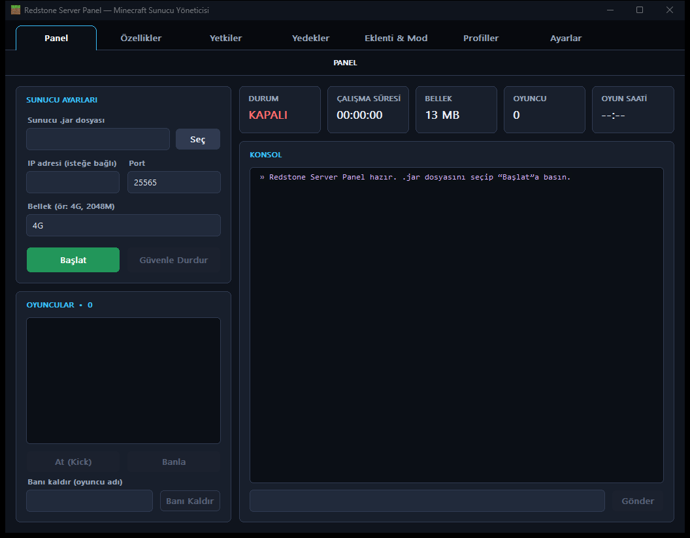
  </a>
</p>

<p align="center">
  <a href="https://qu3zel.github.io/redstonesp/"></a>
  &nbsp;
  <a href="https://github.com/qu3zel/redstonesp/releases"></a>
  &nbsp;
  <a href="https://github.com/qu3zel"></a>
</p>

**Redstone Server Panel** is a modern, lightweight, single-file, zero-dependency Minecraft Java Edition Server Manager for Windows, built with pure Win32 API and GDI/GDI+.

---

## Features / Özellikler

### English
- **Pure Native Win32**: Single C++17 source file (`redstonesp.cpp`), zero external dependencies, tiny memory footprint (~8-12 MB RAM), high-DPI aware.
- **7-Tab Modern Window Architecture**:
  - **Dashboard (Panel)**: Jar, IP, port, RAM, start/stop lifecycle, player list with skins, kick/ban/unban, interactive RichEdit colored console (info, warnings, errors, player chat, outgoing commands), Tab auto-completion for player names & Minecraft commands, command history navigation (Up/Down), live telemetry tiles.
    <details>
      <summary>📸 <i>View Dashboard Preview</i></summary>
      <br>
      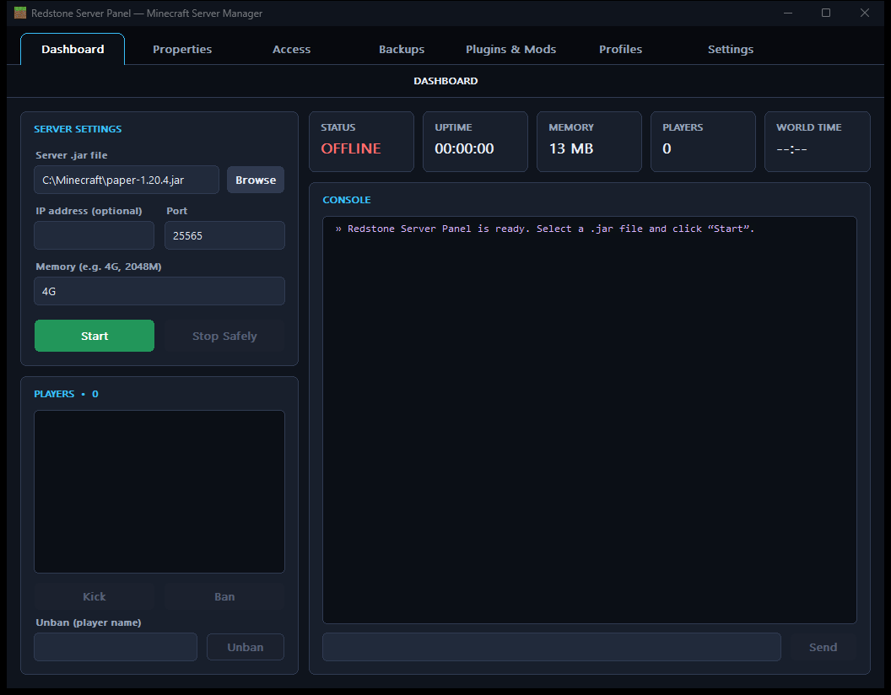
    </details>
  - **Properties (`server.properties`)**: Visual configurator for MOTD, max players, view distance, spawn protection, gamemode buttons, difficulty buttons, PvP, flight, online mode, command blocks.
    <details>
      <summary>📸 <i>View Properties Preview</i></summary>
      <br>
      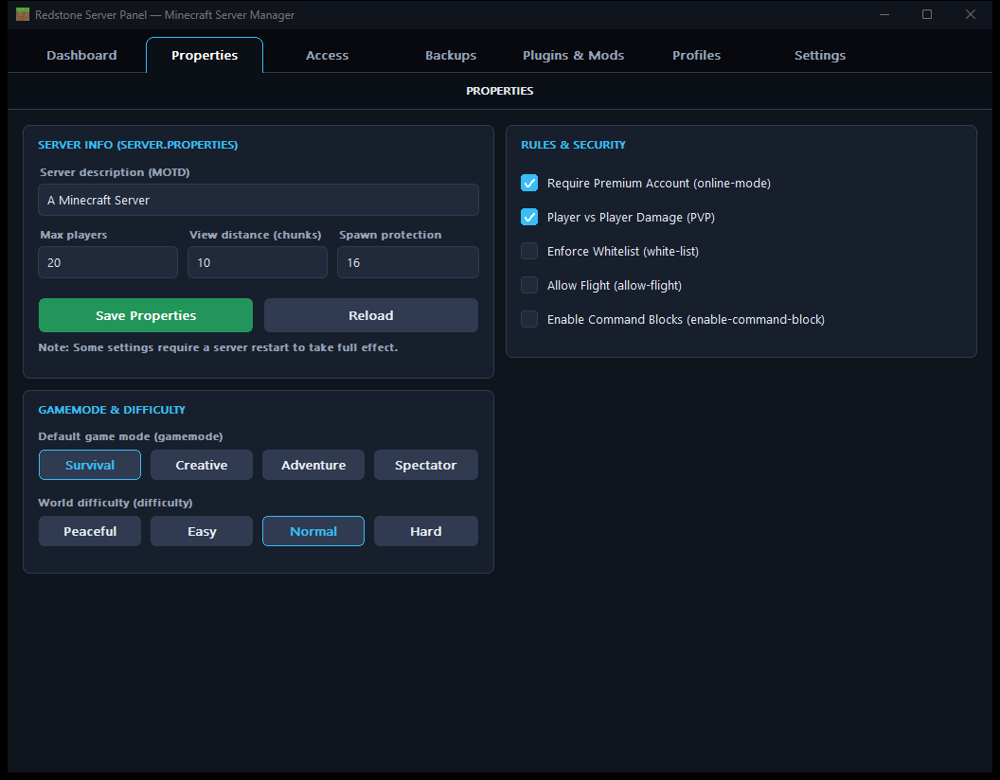
    </details>
  - **Access (`whitelist.json` & `ops.json`)**: Dual card lists with player skinheads, add/remove synchronized with live server commands.
    <details>
      <summary>📸 <i>View Access Preview</i></summary>
      <br>
      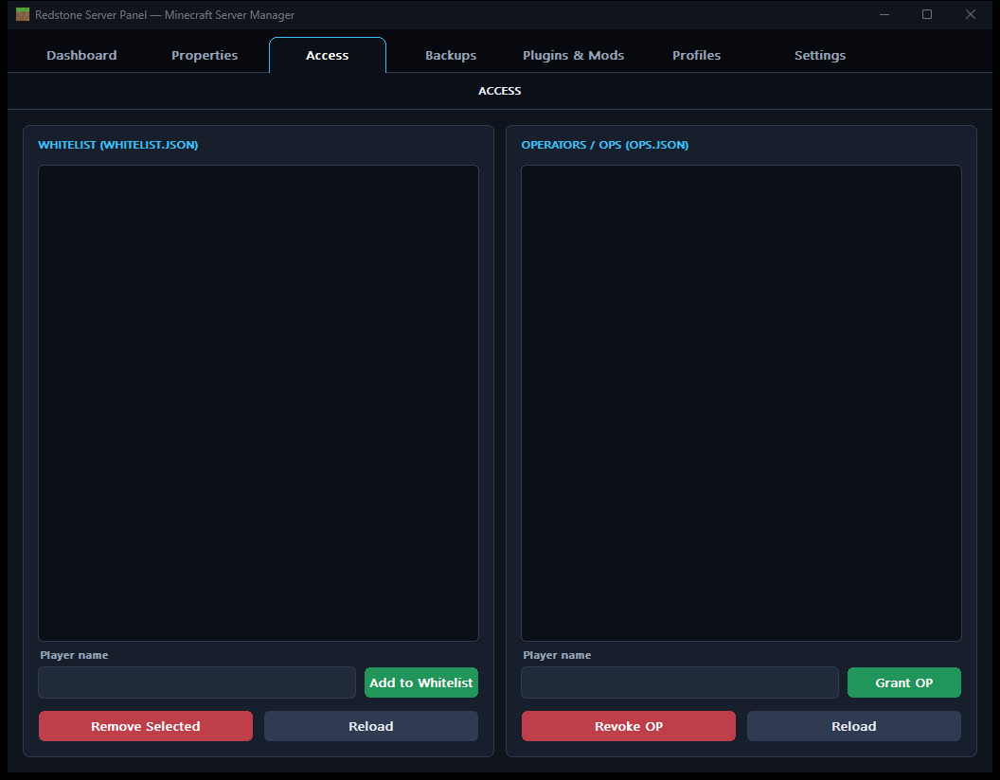
    </details>
  - **Backups**: World compression into `.zip` via native Windows `tar.exe` with automatic `save-all flush`, backup size display, restore, delete, and folder explorer.
    <details>
      <summary>📸 <i>View Backups Preview</i></summary>
      <br>
      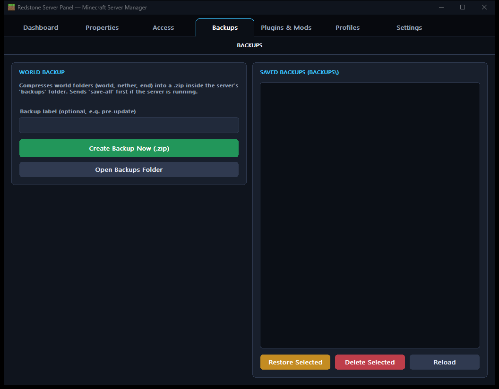
    </details>
  - **Plugins & Mods**: Dual management for `plugins\` and `mods\` folders. One-click enable/disable toggle (`.jar` <-> `.jar.disabled`), file importer, deletion, and folder opener.
    <details>
      <summary>📸 <i>View Plugins & Mods Preview</i></summary>
      <br>
      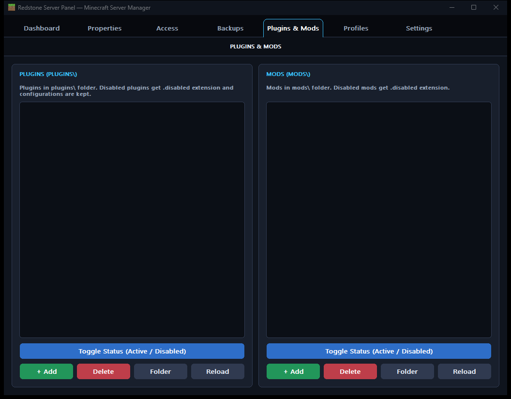
    </details>
  - **Profiles**: Multi-server profile manager stored in `settings.ini`. Save current dashboard configuration as a named profile, switch between servers in one click.
    <details>
      <summary>📸 <i>View Profiles Preview</i></summary>
      <br>
      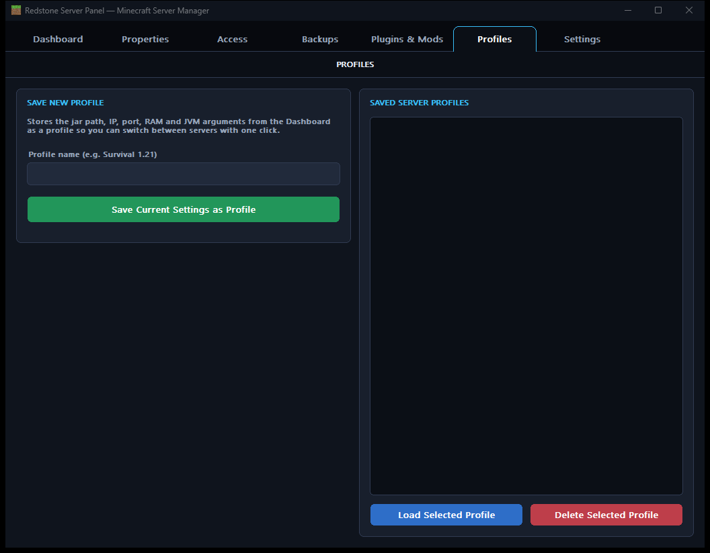
    </details>
  - **Settings & Automation**:
    - *General*: Windows autostart, English/Türkçe language, four themes (Dark, Light, Redstone, Minecraft).
    - *Server*: Crash auto-restart, customizable JVM arguments, logs launcher.
    - *Automation*: Scheduled periodic world auto-backup and daily scheduled restart with in-game 5-minute & 1-minute countdown announcements.
    <details>
      <summary>📸 <i>View Settings Preview</i></summary>
      <br>
      
    </details>

### Türkçe
- **Saf Win32 Performansı**: Tek dosyalı C++17 kaynak kodu (`redstonesp.cpp`), sıfır harici kütüphane bağımlılığı, ultra düşük bellek tüketimi ve yüksek DPI desteği.
- **7 Sekmeli Modern Arayüz**:
  - **Panel (Dashboard)**: Sunucu yapılandırması (.jar, IP, port, RAM), başlatma/durdurma, oyuncu listesi ve kafaları, kick/ban/unban, RichEdit tabanlı renkli konsol (bilgi, uyarı, hata, oyuncu sohbeti, gönderilen komutlar), oyuncu ve komutlar için Minecraft tarzı Tab otomatik tamamlama, komut geçmişi (Yukarı/Aşağı), canlı telemetri kutuları.
    <details>
      <summary>📸 <i>Panel Ekran Görüntüsü</i></summary>
      <br>
      
    </details>
  - **Özellikler (`server.properties`)**: MOTD, oyuncu sayısı, görüş mesafesi, başlangıç koruması, oyun modu ve zorluk butonları, PvP, uçuş, online-mode ve komut bloğu ayarları.
    <details>
      <summary>📸 <i>Özellikler Ekran Görüntüsü</i></summary>
      <br>
      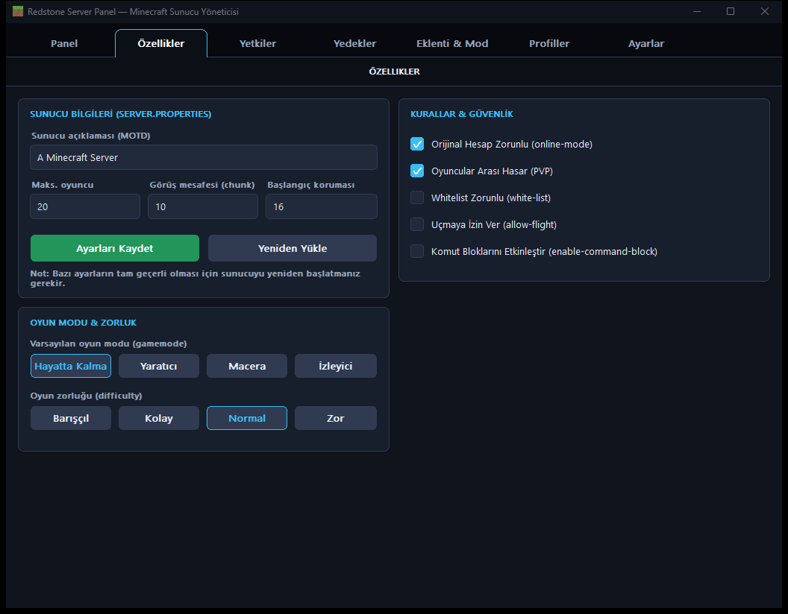
    </details>
  - **Yetkiler (`whitelist.json` & `ops.json`)**: Oyuncu kafalarıyla görselleştirilmiş çift kart listesi, anlık sunucu komutlarıyla tam senkronize ekleme/çıkarma.
    <details>
      <summary>📸 <i>Yetkiler Ekran Görüntüsü</i></summary>
      <br>
      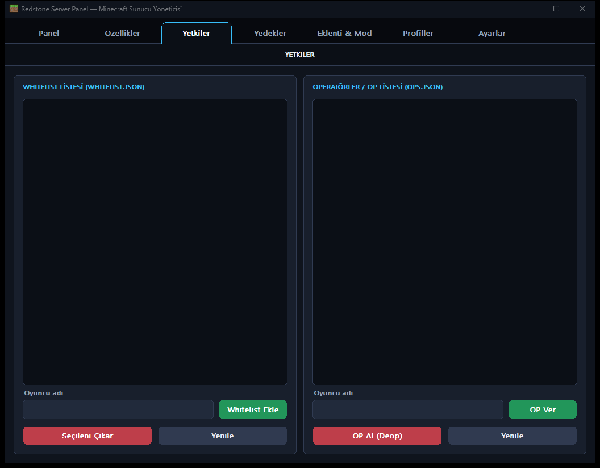
    </details>
  - **Yedekler**: Harici araç gerektirmeden yerel `tar.exe` ile `.zip` formatında dünya yedekleme, otomatik `save-all flush`, tek tıkla geri yükleme ve silme.
    <details>
      <summary>📸 <i>Yedekler Ekran Görüntüsü</i></summary>
      <br>
      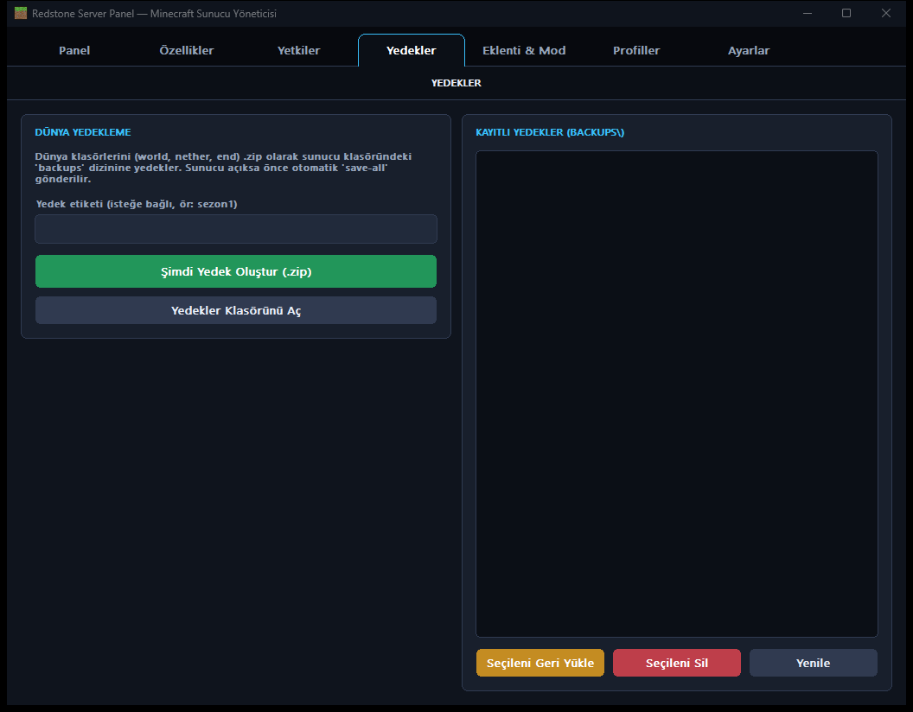
    </details>
  - **Eklenti & Mod (Plugins & Mods)**: `plugins\` ve `mods\` klasörleri için ikili yönetim. Tek tıkla aktif/devre dışı bırakma (`.jar` <-> `.jar.disabled`), eklenti ekleme ve silme.
    <details>
      <summary>📸 <i>Eklenti & Mod Ekran Görüntüsü</i></summary>
      <br>
      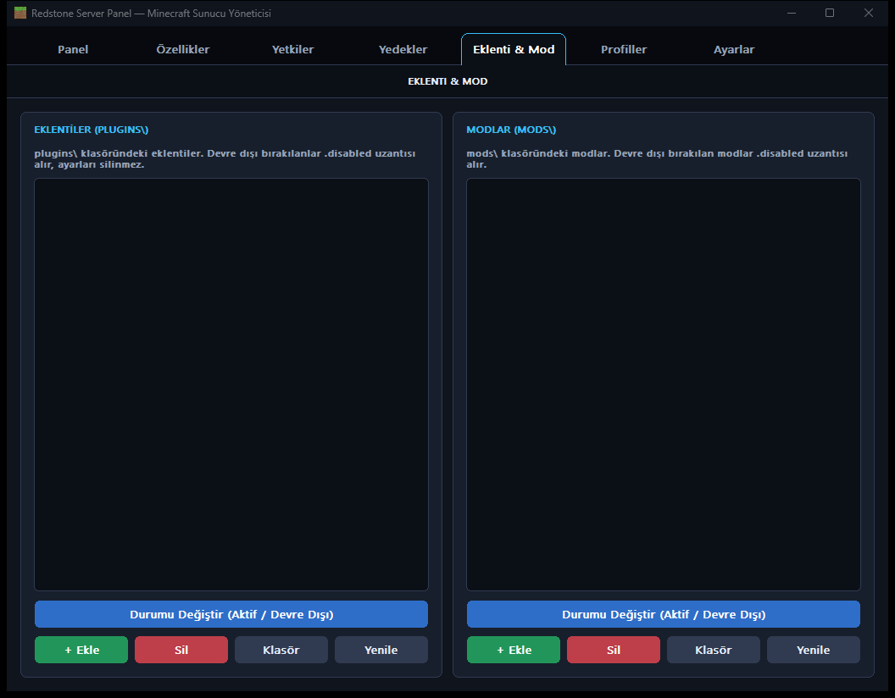
    </details>
  - **Profiller**: `settings.ini` tabanlı çoklu sunucu profilleri. Farklı sunucu ayarlarını profil olarak saklama ve tek tıkla panele yükleme.
    <details>
      <summary>📸 <i>Profiller Ekran Görüntüsü</i></summary>
      <br>
      
    </details>
  - **Ayarlar & Otomasyon**:
    - *Genel*: Windows ile başlatma, Türkçe/İngilizce dil seçimi, dört tema (Koyu, Açık, Redstone, Minecraft).
    - *Sunucu*: Çökme koruması, özel JVM argümanları, log klasörü kısayolu.
    - *Otomasyon*: Belirlenen saat aralığında arka planda sessiz otomatik yedekleme ve oyun içine 5 dk / 1 dk kala anons geçen planlı günlük yeniden başlatma.
    <details>
      <summary>📸 <i>Ayarlar Ekran Görüntüsü</i></summary>
      <br>
      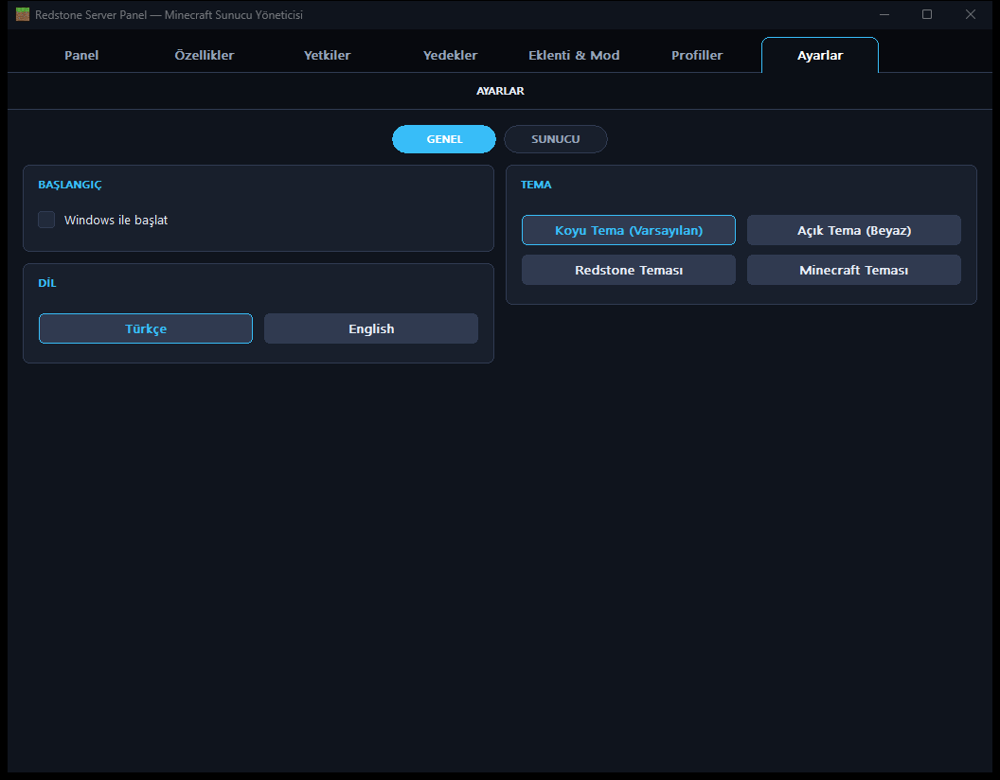
    </details>

---

## Build / Derleme

### MinGW-w64 (GCC)
```bat
build.bat
```
or manually:
```bash
windres resource.rc -O coff -o resource.o
g++ -O2 -s -std=c++17 redstonesp.cpp resource.o -o RedstoneServerPanel.exe \
    -mwindows -static -lcomdlg32 -lpsapi -lshell32 -ladvapi32 -lgdi32 \
    -luser32 -lwinhttp -lgdiplus -lshlwapi
```

### MSVC (Visual Studio Developer Command Prompt)
```bat
rc resource.rc
cl /utf-8 /EHsc /O2 redstonesp.cpp resource.res /Fe:RedstoneServerPanel.exe ^
   /link /SUBSYSTEM:WINDOWS user32.lib gdi32.lib comdlg32.lib shell32.lib ^
   advapi32.lib psapi.lib winhttp.lib gdiplus.lib shlwapi.lib
```

---

## License / Lisans

This project is licensed under the [MIT License](LICENSE).  
Bu proje [MIT Lisansı](LICENSE) kapsamında lisanslanmıştır.

